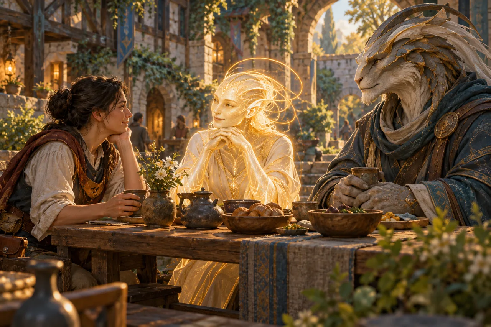

# Guests Before Routes

## Overview

*Guests Before Routes* is an original editorial illustration of exceptional visitors sharing F432 hospitality. It depicts contact, not a crossing method or a documented meeting of named individuals.

## Description

A human host shares a courtyard table with a luminous filament-and-corona guest and a pale, sculptural companion with layered contours. Warm bowls and muted stone ground the unfamiliar bodies in ordinary care. The companion is an imaginative guest silhouette, not an anatomical reference for Draftkin; the luminous figure is likewise a stylized interpretation rather than a species plate.

Asset reference: `assets/guests-before-routes.webp`.

## Role

Out-of-world concept artwork; no in-world maker, historical occasion, or transport service is asserted. The present timeline fields describe its depicted contact baseline.

## Lore Connection

Aurel-kind and Draftkin visits are genuine even when hosts cannot reproduce their passage. A shared table is not evidence of a public route.

## Notes

Generated with the built-in image generation tool; optimized as WebP. Prompt: painterly F432 stone-and-timber courtyard, human host listening to a gold-white filament guest with honey rings and a dignified Draftkin with revision seams; tea and bowls, amber and slate teal, restrained wonder; no portal, vehicles, tickets, captions, or technology demonstration. This is an illustrative composite, not additional canon about visitor anatomy or a specific encounter.
