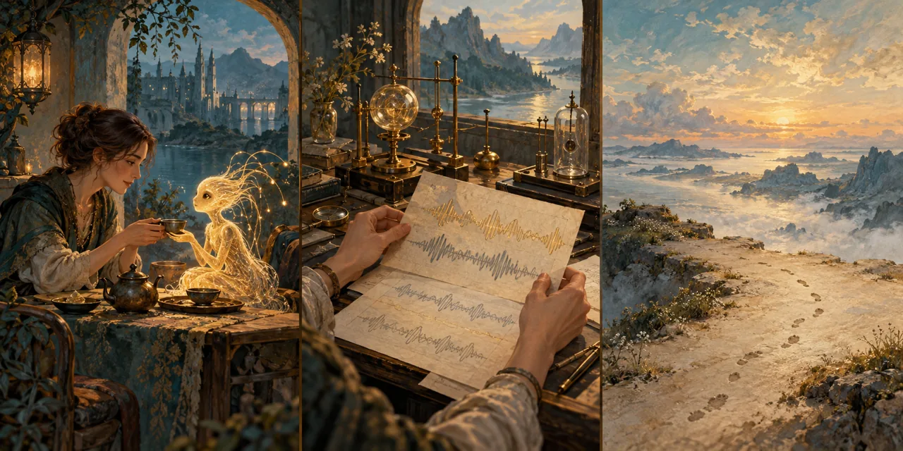

# Measurements and Unwritten Journeys

## Overview

*Measurements and Unwritten Journeys* is a symbolic editorial triptych about contact, reproducible observation, and an unwritten future. It records no future event or crossing technology.

## Description

Tea shared with a small luminous visitor gives way to a brass-and-glass measurement bench and repeated traces on paper, then to an open painted horizon with tentative footprints. Honey light and slate teal connect the three images. The small guest is a symbolic figure, not a new species or an anatomical reference for Aurel-kind.

Asset reference: `assets/measurements-and-unwritten-journeys.webp`.

## Role

Out-of-world concept artwork. The bench is an illustrative instrument, not a technical specification for the Spectrum Frame. The final panel represents possibility, not an achieved crossing. Timeline fields locate the present orientation work; they do not place a future journey in current history.

## Lore Connection

Calibration establishes reproducible measurements without creating the initial existence of other realms. Later stories may earn controlled crossings and eventual journeys without retroactively giving their capabilities to earlier characters.

## Notes

Generated with the built-in image generation tool; optimized as WebP. Prompt: painterly literary fantasy triptych, exceptional guest sharing tea, brass-and-glass resonance measurement bench with repeated abstract traces, unfinished parchment horizon and fading footprints; muted slate teal, honey gold and parchment; no words, numbered eras, crossing devices, spacecraft, gates, ferries, or claimed mechanism.
